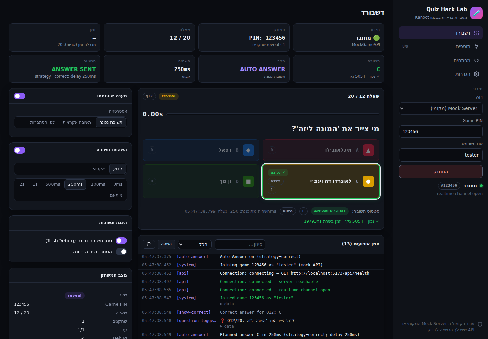

# 🧪 Quiz Hack Lab

אפליקציית Web מלאה בסגנון **"Kahoot Hack Lab"** לפיתוח ובדיקות — Auto Answer, Answer Delay, Auto Reconnect,
Developer Mode, Live Event Console ועוד — שעובדת **רק מול Mock Server מקומי** (נכלל בפרויקט) או מול API
שיש לך הרשאה להשתמש בו.

> ⚠️ הפרויקט **לא** מתחבר למשחקי Kahoot אמיתיים, לא משתמש ב-API פרטי של Kahoot ולא עוקף שום מנגנון אבטחה.
> דומיינים של Kahoot חסומים בקוד (`shared/src/security.ts`).



## התקנה והרצה

דרישות: **Node.js 22+** (יש בו `WebSocket` ו-`fetch` מובנים) ו-npm 10+.

```bash
cd quiz-lab
npm install
npm run dev
```

* UI: <http://localhost:5173>
* Mock Server: <http://localhost:4000> (REST, גם תחת `/api`) · WebSocket: `ws://localhost:4000/ws`
* משחק דמו נוצר אוטומטית: **PIN `123456`**, host token `dev-host-token`, מתחיל 3 שניות אחרי שהשחקן הראשון מצטרף ומתחיל מחדש בסיום.

לחץ **התחבר** בסרגל הצד — ה-Auto Answer יענה לבד לפי ההגדרות.

### מצב פשוט (עמוד הפתיחה)

* **🎮 התחל משחק סולו** — יוצר משחק פרטי רק בשבילך ומצטרף אליו.
* **⚡ Auto Answer** — כפתור אחד להפעלה/כיבוי; בוחרים **מיד** או **אחרי X שניות**.
* **👁 הצג את כל התשובות** — מסמן את התשובה הנכונה בשאלה הנוכחית ומציג מפתח תשובות לכל המשחק
  (`GET /dev/answer-key` — רק למארח המשחק: משחק סולו או ה-host token של הדמו).

קונפיגורציה אופציונלית: `cp .env.example .env` (הכל עובד גם בלי).

### פקודות

| פקודה | תיאור |
|---|---|
| `npm run dev` | Mock Server (tsx watch) + Vite במקביל |
| `npm test` | כל חבילת הבדיקות (vitest) — יחידה, אינטגרציה HTTP/WS ו-end-to-end |
| `npm run typecheck` | TypeScript strict לכל ה-workspaces |
| `npm run build` && `npm start` | בניית ה-UI והגשתו מתוך ה-Mock Server על פורט 4000 |

## מבנה

```
quiz-lab/
├── frontend/   React + Vite — Dashboard, Plugins, Developer Mode, Settings (RTL/LTR, Dark/Light)
├── backend/    Mock Server — Express + ws: מנוע משחק, טיימרים, ניקוד, leaderboard, WebSocket hub
├── shared/     טיפוסים, אירועים, GameAPI + MockGameAPI + OfficialGameAPI + MockHostAPI, אסטרטגיות
├── plugins/    LabSession (runtime) + PluginManager + 9 מודולים עצמאיים
└── docs/       ARCHITECTURE · API · PLUGINS · RESEARCH
```

## פיצ'רים

| תחום | מה יש |
|---|---|
| **UI** | Dark mode כברירת מחדל, RTL לעברית / LTR לאנגלית, Sidebar, Game PIN, Username, Connect, סטטוס חיבור, מספר שאלה, טקסט, תשובות, טיימר (עם תיקון הפרש שעון מול השרת), מצב משחק, Event log |
| **Dashboard** | Connection · Game PIN · Question `7 / 20` · Time `8.42s` · Answer · Mode · Delay · Status (`ANSWER SENT`…) |
| **AUTO ANSWER** | תשובה נכונה / אקראית / לפי הסתברות. בשרת הדמו (debug) השרת מחזיר `correctAnswerId` |
| **ANSWER DELAY** | 0 / 100 / 250 / 500ms / 1s / 2s / Custom, או Random בין Min ל-Max |
| **SHOW ANSWERS** | כל האפשרויות, סימון התשובה הנכונה במצב Test/Debug, אפשרות להסתיר |
| **QUESTION MONITOR** | זיהוי שאלה חדשה, מספר, זמן שנותר, סטטוס תשובה, התפלגות אחרי החשיפה |
| **AUTO JOIN** | התחברות אוטומטית עם ה-PIN וה-username השמורים |
| **AUTO RECONNECT** | Exponential backoff, מגבלת ניסיונות (ברירת מחדל 5), re-join אם השרת "שכח" את השחקן |
| **Plugins** | 9 מודולים עצמאיים עם הפעלה/כיבוי — [docs/PLUGINS.md](docs/PLUGINS.md) |
| **Developer Mode** | הפעלת שאלות ידנית, שינוי טיימר, שינוי תשובה נכונה, שליחת שאלות מותאמות, יצירת משחקים, סימולציית ניתוק, WebSocket events, API requests/responses, latency, answer timestamps |
| **WebSocket** | `question_started`, `question_updated`, `answer_submitted`, `question_ended`, `game_ended`, `player_joined`, `player_left` (+ `hello`, `game_started`, `game_reset`, `pong`) |
| **Settings** | API URL, WebSocket URL, username, default delay, auto reconnect, debug mode, theme, language — נשמר ב-localStorage |

## API Layer

ה-UI לא מדבר עם השרת ישירות — הוא קורא ל-`LabSession`, שמשתמש בממשק `GameAPI`:

```ts
connect() · joinGame(pin, username) · getGameState() · getQuestion() · submitAnswer(answerId) · disconnect()
```

* `MockGameAPI` — מול ה-Mock Server המקומי (REST + WebSocket).
* `OfficialGameAPI` — placeholder מוכן לחיבור עתידי ל-API ציבורי/מורשה (כרגע זורק `NotImplementedError`).

החלפה: **Settings → API implementation** (או `createGameAPI(kind, config)` בקוד). פירוט מלא: [docs/API.md](docs/API.md).

## Mock Server

`POST /game/create` · `POST /game/join` · `GET /game/state` · `GET /game/question` · `POST /game/answer` · `GET /game/results`
+ נתיבי Developer תחת `/dev/*` (דורשים host token). תומך בכמה שחקנים, טיימר, ניקוד לפי מהירות,
leaderboard, שאלות מותאמות, סיום מוקדם כשכולם ענו, rate limit בצד השרת.

```bash
curl -X POST localhost:4000/game/join -H 'content-type: application/json' -d '{"pin":"123456","username":"curl"}'
```

## למה נבנה מאפס? (מחקר GitHub)

נבדקו ClassQuiz (MPL-2.0), kahoot.js-updated (MIT, אבל מבוסס על ה-API הפרטי של Kahoot), Kitty-Tools (CC0, כלי רמאות),
ושכפולי Kahoot קטנים (ללא רישיון). אף אחד לא התאים כבסיס לפורק — אז הקוד נכתב מאפס, עם השראה ארכיטקטונית
מ-ClassQuiz (שרת סמכותי + אירועי realtime לפי PIN) ומ-kahoot.js (client שמפיץ אירועי משחק). ההשוואה המלאה:
[docs/RESEARCH.md](docs/RESEARCH.md).

## ארכיטקטורה

תרשים (Mermaid + ASCII) והסבר זרימת שאלה/תשובה/חיבור מחדש: [docs/ARCHITECTURE.md](docs/ARCHITECTURE.md).

## אבטחה

* אין עקיפת authentication, אין גניבת tokens, אין endpoints פרטיים, אין עקיפת rate limits.
* שחקן יכול לפעול רק עם ה-player token שלו; פעולות Developer דורשות host token.
* `MockGameAPI` ו-`OfficialGameAPI` מסרבים לכתובות של kahoot.it / kahoot.com.
* הכל גלוי ומתועד ב-Network Debugger וב-Event log — שום פעילות לא מוסתרת.

## בדיקות

```bash
npm test
```

59 בדיקות: אסטרטגיות ומנוע המשחק (fake timers), REST + WebSocket אמיתיים, pipeline של הפלאגינים,
Auto Reconnect עם מגבלת ניסיונות, שמירת הגדרות, ובדיקת end-to-end של `LabSession ↔ MockGameAPI ↔ Mock Server`.
