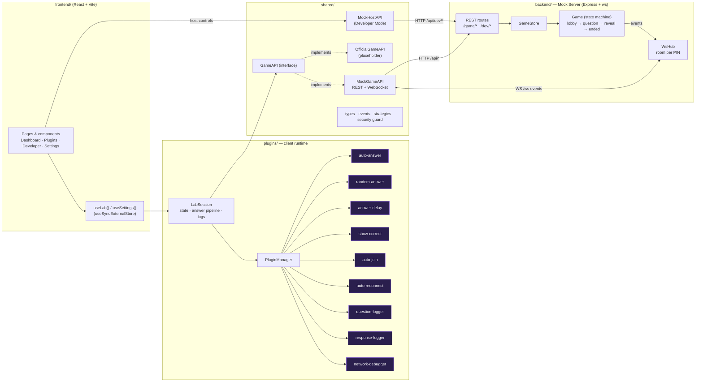

# Architecture



ASCII version:

```
┌──────────────── frontend (React) ────────────────┐
│ Sidebar · Dashboard · Plugins · Developer · Settings │
│             │ useLab()/useSettings()              │
└─────────────┼────────────────────────────────────┘
              ▼
┌──────────── plugins/ LabSession ─────────────┐     ┌──── shared/ ─────┐
│ state store · answer pipeline · logs         │────▶│ GameAPI interface │
│ PluginManager → [auto-answer][random]        │     │  ├ MockGameAPI    │──HTTP /api──┐
│   [delay][show-correct][auto-join]           │     │  └ OfficialGameAPI│             │
│   [auto-reconnect][loggers][network-debug]   │     │ MockHostAPI (dev) │──HTTP /dev──┤
└──────────────────────────────────────────────┘     └───────────────────┘             │
                                                              ▲ WS /ws events          ▼
                                            ┌──────── backend/ Mock Server ──────────────┐
                                            │ Express routes → GameStore → Game (timers,  │
                                            │ scoring, leaderboard) → WsHub (room per PIN)│
                                            └─────────────────────────────────────────────┘
```

## Layers

| Layer | Folder | Responsibility |
|---|---|---|
| **UI** | `frontend/` | Renders `LabState`, calls `LabSession` methods. Never touches `fetch`/`WebSocket` for gameplay. |
| **Runtime** | `plugins/src/core` | `LabSession` owns the current `GameAPI`, the observable state, and runs plugin hooks. |
| **Plugins** | `plugins/src/modules` | One file per feature. Enabled/disabled independently; isolated from each other's errors. |
| **API layer** | `shared/src/api` | `GameAPI` interface + implementations. Swap implementation via `createGameAPI(kind, config)` / the *API implementation* setting. |
| **Mock Server** | `backend/` | Authoritative quiz engine; REST for commands, WebSocket for events. |

## Data flow for one question

1. Server `Game.startQuestion()` → broadcasts `question_started` (with `correctAnswerId` only in debug games).
2. `MockGameAPI` receives the frame → emits `event` (and a `network` entry).
3. `LabSession.handleQuestion()` stores it, dispatches `onQuestion` (Question Logger, Show Correct).
4. If **Auto Answer** is enabled, `buildPlan()` runs `planAnswer` hooks in order:
   `auto-answer (10)` → `random-answer (20)` → `answer-delay (30)`.
5. After `plan.delayMs` the session calls `api.submitAnswer()`; the result is recorded
   (`AnswerRecord`: seen/sent timestamps, RTT, server-elapsed, points) and dispatched to
   `onAnswerResult` (Response Logger).
6. Server ends the question (timer or everyone answered) → `question_ended` → leaderboard update.

## Timing & clocks

The server is the only clock that matters for scoring. Every event carries `serverTime`; the client
keeps a smoothed `clockOffsetMs = serverTime − Date.now()` and computes the countdown as
`endsAt − (Date.now() + offset)`, so the timer stays correct even if the client clock is off.

## Reconnect model

* Unexpected socket close → `connection {status: "disconnected", unexpected: true}`.
* Auto Reconnect schedules attempts with exponential backoff (500ms → 8s cap) up to
  `maxReconnectAttempts`, then stops (`reconnect.exhausted = true`).
* Close codes `4001` (invalid token) / `4004` (game gone) / `4009` (replaced) are *fatal*: the plugin
  switches to **re-join** (same PIN + username, new player) instead of re-opening the socket.
* Success is confirmed only by the server's `hello` frame, so a socket that opens and is immediately
  rejected never resets the attempt counter (no infinite loop).
* Players whose socket never comes back are removed after `PLAYER_DISCONNECT_GRACE_MS`; the browser
  also sends `POST /game/leave` (keepalive fetch) on `pagehide`.
